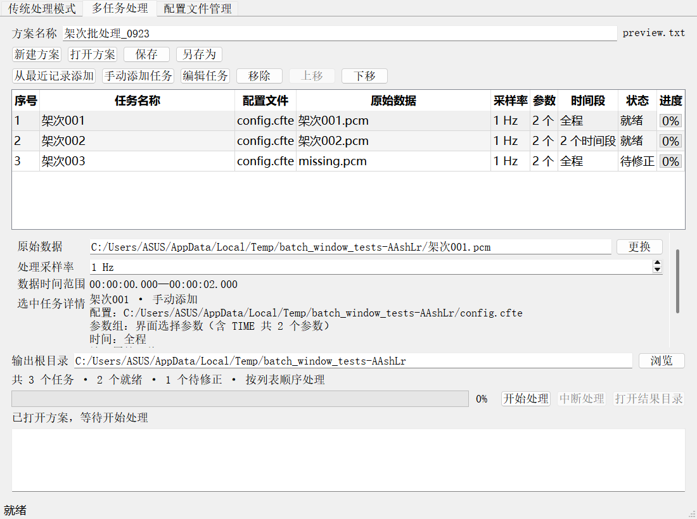
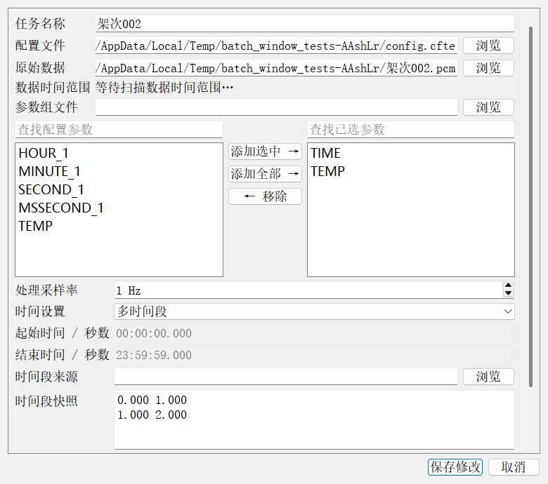

# 多任务处理使用与开发说明

本目录是原项目的源码副本：`D:\kaifa\newPcmProcess-batch`。原目录 `D:\kaifa\newPcmProcess` 未修改。
复制包含当时尚未提交的结果输出优化；未复制 Git 元数据、旧构建缓存、大型生成数据或仓库备份包。
`.source-snapshot.json` 保存复制时 77 个源文件的 SHA-256，便于核对原目录。

## 使用方法

1. 启动 `app/pcm_process_gui.exe`，切换到“多任务处理”。程序依赖随 `app` 目录提供。
2. 点击“从最近记录添加”勾选多条最近单任务记录，或点击“手动添加任务”。两种来源可以混用。
3. 选中任务后直接修改原始数据和采样率；“编辑任务”可修改配置、参数、时间段及原始码值选项。
4. 设置方案名称、任务顺序和输出根目录。失效文件或不完整设置显示“待修正”。
5. 点击“保存”创建 `.txt`，以后可直接保存或另存为；打开方案只恢复设置，不会启动处理。
6. 点击“开始处理”对全部任务统一检查，检查通过后按列表顺序执行。一条任务的所有时间段结束后才执行下一条。
7. 运行中可以查看详情、保存方案或中断。运行时错误记录在该行并继续后续任务；启动前错误需要先修正。
8. 完成后使用“打开结果目录”查看结果。中断保留已提交文件，剩余任务显示“未执行”。

最近记录仍使用现有应用的 QSettings，因此副本程序可以读取现有的最近二十条单任务记录。
多任务执行不会挤占单任务历史。两种处理模式不能同时启动。

## 方案与结果

`.txt` 为 UTF-8 JSON，格式标识 `pcm-batch`，版本 `1`。
保存任务顺序、名称、绝对文件路径、采样率、实际参数列表、时间段快照、码值选项及来源信息。
配置和原始数据通过路径引用，未打包进方案。参数组和时间段已快照化，源辅助文件删除后仍可复用。
旧历史中的多时间段记录没有快照时会尝试读取原 TXT；读取失败后可在编辑器中重新导入或输入时间段。
允许保存待修正方案；损坏文件或不支持的版本不会替换当前工作内容；保存使用 QSaveFile 原子提交。
运行状态和百分比不写入方案，重新开始按完整列表执行，不提供断点续跑或自动重试。

每次开始创建独立目录：

```text
输出根目录/
  方案名称_运行时间_唯一标识/
    batch.log
    batch-summary.json
    001_任务名称/
      result.txt
    002_任务名称/
      result_range001.txt
      result_range002.txt
```

`batch.log` 记录本轮生命周期及解算日志；`batch-summary.json` 记录每个任务的最终状态、错误和已生成文件。
任务目录按序号隔离，同一历史记录可重复添加；重复运行创建新目录，不覆盖上次结果。
总进度按任务等权计算，失败任务计入已结束数量，结束时明确显示是否存在失败；中断不强制填满进度。

## 代码结构

- `BatchPlan` / `BatchTaskItem` / `BatchPlanFile`：文档快照及版本化原子保存。
- `BatchTaskModel`：Qt 表格模型，设置与运行状态分离，执行期间锁定修改。
- `ProcessingHistoryStore`：共享读取旧历史，新增记录补充时间段快照。
- `ProcessingOptionsSupport`：单任务与多任务共用字段转换、参数组解析、基础校验。
- `ProcessingConfigCache`：批次预检及执行共享只读配置和布局，按路径与内容指纹失效。
- `BatchTaskEditor` / `BatchProcessingPage`：任务编辑、历史多选、方案操作和进度日志。
- `BatchProcessingController`：单任务串行调度，失败继续、中断停止派发、输出隔离。
- `TraditionalProcessingController::processingSettled`：全部范围及处理资源释放后的唯一请求终态。

时间扫描每个窗口最多一个后台任务，通过取消标记与版本隔离过期结果，不改变用户手动设置的时间。
单任务原有解算、原始码值、多时间段输出和已有结果输出优化仍由原处理链负责。

## 构建与测试

当前验证环境为 Windows、Qt 5.14.2、MinGW 7.3、C++17、Release。
源码使用 Qt 跨平台接口；Linux、macOS 与 Qt 6 尚未在本次环境编译验证。

```powershell
$env:PATH = 'D:\qt\Tools\mingw730_64\bin;D:\qt\5.14.2\mingw73_64\bin;' + $env:PATH
cmake -S . -B build-batch -G 'MinGW Makefiles' `
  -DCMAKE_BUILD_TYPE=Release `
  -DCMAKE_CXX_COMPILER=D:/qt/Tools/mingw730_64/bin/g++.exe `
  -DCMAKE_MAKE_PROGRAM=D:/qt/Tools/mingw730_64/bin/mingw32-make.exe `
  -DQt5_DIR=D:/qt/5.14.2/mingw73_64/lib/cmake/Qt5 `
  -DBUILD_TESTING=ON
cmake --build build-batch --parallel 4
ctest --test-dir build-batch --output-on-failure --timeout 90 --parallel 4
```

测试包含新增的 `batch_plan_tests`、`batch_processing_controller_tests`、`batch_window_tests`，以及全部原有测试。
覆盖方案往返/损坏/保存失败、旧历史兼容、缓存失效、排序与锁定、多时间段串行、运行失败继续、中断保留结果、
重跑隔离、资源清理后复用、历史独立编辑、保存提示、跨页互斥及快速切换时拒绝旧扫描。
Windows 界面测试使用现有项目的 `windows` Qt 平台插件；该 Qt 版本的 `offscreen` 插件在 QMessageBox 中发生崩溃。

## 界面截图




